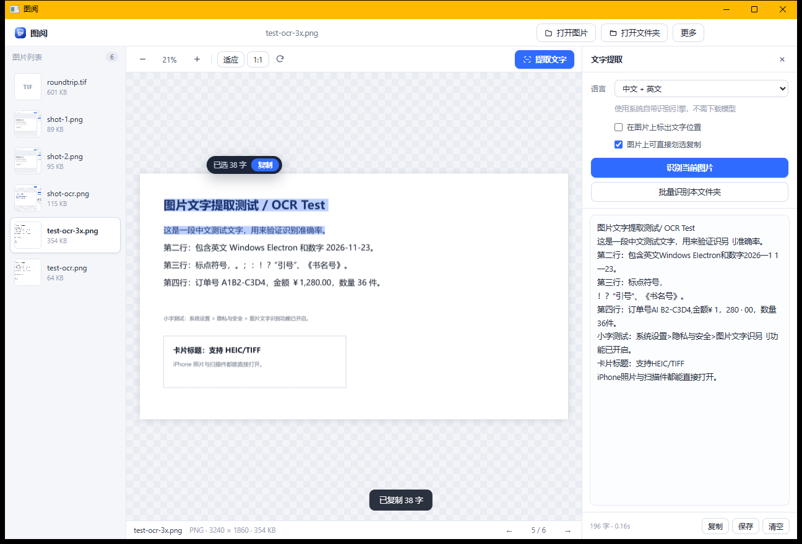

<div align="center">
  
  <h1>图阅 · Tuyue</h1>
  <p>Windows 看图工具，带 <b>图上直接划选文字复制</b>、<b>内容识别填充</b>、<b>四向拼接</b>。<br>全离线，不联网，免安装，<b>3 MB</b>。</p>
  <p>
    
    
    
    
  </p>
</div>



## 为什么只有 3 MB

不用 Electron，把三件重活全交给系统：

| 环节 | 做法 | 省下的体积 |
|---|---|---|
| 界面 | 系统自带 WebView2（Win10/11 预装）+ 内嵌 HTML/JS/CSS | 不打包 Chromium，省 ~150 MB |
| 图片解码 | 系统 WebView2 的图像栈 + libheif / UTIF 单文件库 | 不打包图像库 |
| 文字识别 | `Windows.Media.Ocr`（系统自带引擎，中英混排） | 不打包 30 MB 模型 |

外壳是 Rust + [wry](https://github.com/tauri-apps/wry) + [tao](https://github.com/tauri-apps/tao)，源码约 4,600 行（Rust 1,400 / 前端 2,100 / 脚本 1,000）。

## 下载

到 [Releases](../../releases) 下载 `tuyue-v0.1.0-win64.zip`，解压双击 `图阅.exe` 即可，免安装、绿色版。

## 功能

**看图**
- 格式：JPG / PNG / APNG / GIF（动图）/ WEBP（动图）/ BMP / ICO / SVG / AVIF / TIFF / HEIC / HEIF
- 打开单个文件、整个文件夹，或把图片 / 文件夹拖进窗口
- 左侧缩略图列表，`←` / `→` 切换
- 滚轮以光标为中心缩放、拖动平移、双击在「适应窗口 / 100%」间切换
- 旋转 90°，状态栏显示格式、像素尺寸、文件大小，多页 TIFF 提示总页数

**图上划选文字**
- 点「识别当前图片」（工具栏「提取文字」或快捷键 <kbd>E</kbd>），图上会覆盖一层**透明的真实文本**（与识别框逐行对齐，肉眼看不见）
- 按住鼠标划选就是系统原生选区，浅蓝高亮；双击选词，<kbd>Ctrl</kbd>+<kbd>A</kbd> 全选整图文字
- <kbd>Ctrl</kbd>+<kbd>C</kbd>、右键复制、点浮出的「复制」都能拿到文字，跨行保留换行
- 结果可编辑、保存为 TXT，也能「批量识别本文件夹」
- **识别只在你点的时候跑**，打开图片不做任何识别

**内容识别填充**
- 工具栏「框选」（快捷键 <kbd>M</kbd>）在图上拖框，点浮出的「内容识别填充」，框内文字 / 物体被抹掉、背景补齐
- 默认语义是**只擦内容、保留背景**：淡黄纸上的黑字擦完，纸还是原来那张纸
- 也可以直接用「擦掉文字（保留背景）」按识别结果逐行清理整页文档

| 背景类型 | 算法 | 耗时（一行字） |
|---|---|---|
| 纯色 / 渐变（文档、截图、海报） | 只擦内容 + 就近取底色软混合 | **3–7 ms** |
| 照片 / 纹理（草、墙、布料） | 多尺度 PatchMatch + EM 重建 | 0.5–2 s |

**拼接**
- 把另一张图拖到**图片四边**：进窗口时四边亮起「拼到上方 / 下方 / 左侧 / 右侧」，中间是「打开这张图」
- 松手即拼，水平按上边对齐、垂直按左边对齐，尺寸不同处补白

**编辑**
- 撤销 6 步（<kbd>Ctrl</kbd>+<kbd>Z</kbd>）、另存为 PNG（<kbd>Ctrl</kbd>+<kbd>Shift</kbd>+<kbd>S</kbd>），**原文件永不覆盖**

**设为系统默认看图软件**
- 菜单「更多 → 设为默认看图软件」，正规三层注册（ProgID / `Applications` / `Capabilities`），全写 `HKCU`，不需要管理员
- Windows 8 起默认程序由带微软签名哈希的 `FileExts\<扩展名>\UserChoice` 决定，第三方无法伪造，所以要你最后去系统界面点一次确认

## 快捷键

| 键 | 作用 |
|---|---|
| <kbd>Ctrl</kbd>+<kbd>O</kbd> / <kbd>Ctrl</kbd>+<kbd>Shift</kbd>+<kbd>O</kbd> | 打开图片 / 打开文件夹 |
| <kbd>←</kbd> <kbd>→</kbd> · <kbd>PageUp</kbd> <kbd>PageDown</kbd> | 上一张 / 下一张 |
| <kbd>Ctrl</kbd>+<kbd>=</kbd> / <kbd>-</kbd> · <kbd>Ctrl</kbd>+<kbd>0</kbd> / <kbd>1</kbd> | 缩放 · 适应窗口 / 1:1 |
| <kbd>R</kbd> | 旋转 90° |
| <kbd>E</kbd> / <kbd>Ctrl</kbd>+<kbd>E</kbd> | 识别当前图片 |
| <kbd>Ctrl</kbd>+<kbd>A</kbd> / <kbd>Ctrl</kbd>+<kbd>C</kbd> | 全选图上文字 / 复制所选 |
| <kbd>M</kbd> | 框选内容识别填充 |
| <kbd>Ctrl</kbd>+<kbd>Z</kbd> / <kbd>Ctrl</kbd>+<kbd>Shift</kbd>+<kbd>S</kbd> | 撤销 / 另存为 PNG |
| <kbd>Esc</kbd> | 收起面板 |

## 构建

需要 Windows + [Rust](https://rustup.rs/)。推荐 MSVC 工具链（装 Visual Studio Build Tools 的「使用 C++ 的桌面开发」）：

```powershell
cd app
cargo build --release
```

产物 `app\target\release\图阅.exe`，把 `WebView2Loader.dll`（在同一次构建的
`target\release\build\webview2-com-sys-*\out\x64\` 下）放到 exe 旁边即可运行。

若用 `x86_64-pc-windows-gnu` 工具链而本机没有 gcc，需指定 `rust-lld` 作链接器，
见 [`app/.cargo/config.toml.example`](app/.cargo/config.toml.example)。

`build.rs` 会把 `app/res/app.rc` 里的图标和版本信息写进 exe，依赖 `windres`（binutils）
和一个原样透传的假预处理器 [`tools/fakecpp.py`](tools/fakecpp.py)。**windres 缺失时只警告，不阻断构建**——只是 exe 没有图标和版本信息。

### 无人值守自检

```powershell
图阅.exe --shot --shot-ocr --shot-png --shot-copy "某张图.png"
```

在 exe 同目录产出 `shot.json`（页面 / 文字层 / 选区诊断）和 `shot.bmp`（窗口截图），
并把选中的两行文字写进剪贴板。另有 `--shot-fill`（框选填充）、`--shot-erase`（整页擦字）、
`--shot-stitch`（拼接落点判定）三个自检开关。

## 技术说明

- Rust + wry 0.57 + tao 0.37；界面资源用 `include_bytes!` 编进 exe，自定义 `app://` 协议提供页面
- OCR 走 `Windows.Media.Ocr`（WinRT）。**必须放在独立线程并先 `CoInitializeEx`**，否则 `.get()` 会把消息循环堵死
- 文字层做法：OCR 返回逐词矩形与行号 → 每行一个透明 `div`，字号按行高、宽度用 `scaleX` 拉到识别框宽度 → 选区直接复用系统原生选区
- 跨行复制由 `copy` 事件接管，按行拼 `\n` 写剪贴板（原生序列化会把两行粘成一句）
- WebView2 缓存目录指到 `%LOCALAPPDATA%\Tuyue\WebView2`，程序目录保持干净
- 注册表读写用 `winreg`；单实例用命名 Mutex + Event 转发第二个实例的路径
- 内容识别填充在 [`app/src/inpaint.rs`](app/src/inpaint.rs)：多尺度金字塔 + PatchMatch 近邻场 + EM 投票重建；
  洞边缘色差小时走「只擦内容 + 多源 BFS 就近取底色 + 按距离软混合」的快路径
- 填充和 OCR 一样走独立线程，像素与选区以 base64 传，不占消息循环
- 拖放用 `wry::DragDropEvent` 的 Enter/Over/Drop 落点（wry 已做 `ScreenToClient`，物理像素 ÷ dpr 得 CSS 像素），
  前端按「离图片哪条边最近」判定方向；**基准必须是图片实际显示的矩形**，不能用画面容器百分比——否则图片周围留白会被误判成中间，拖入的图直接把当前图替换掉

## 已知限制

- 有 `UserChoice` 的扩展名需用户在系统界面确认一次（Windows 强制）
- 多页 TIFF 只显示第一页
- RAW 相机格式（CR2 / NEF / ARW / DNG）、PSD 不支持
- 绿色版不带安装器，不在「程序和功能」里，移动位置后需重新点一次「设为默认」

## 许可

[MIT](LICENSE)
